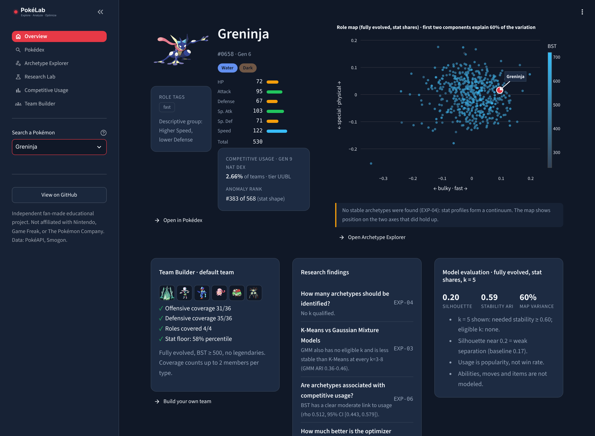
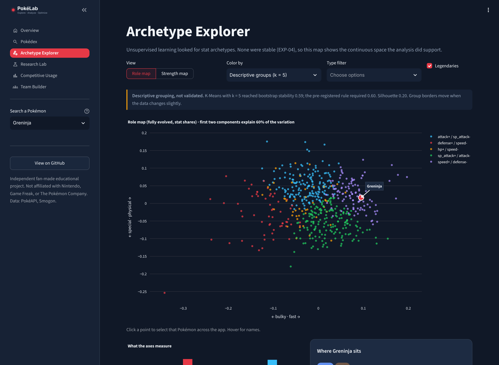
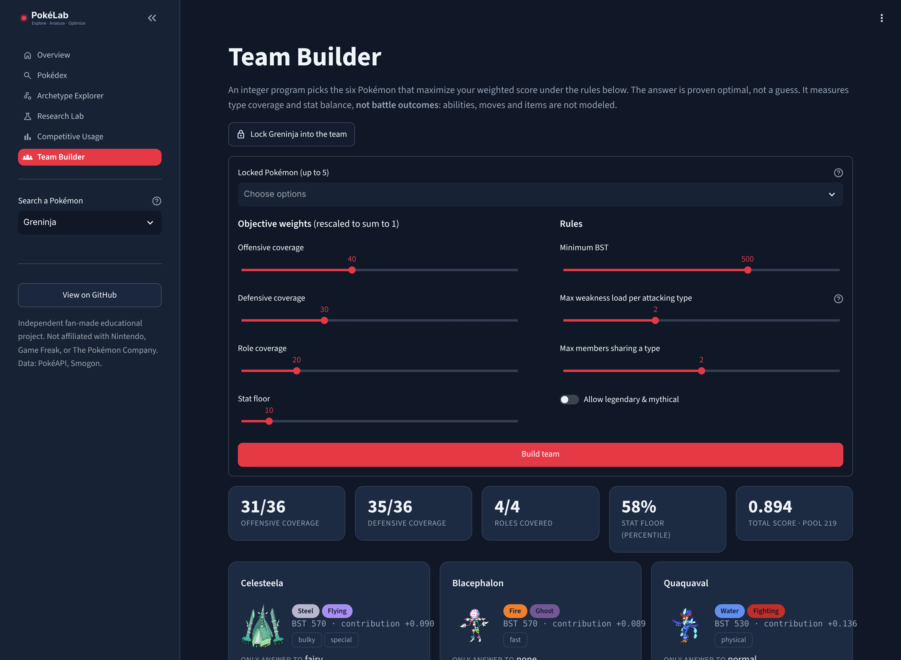
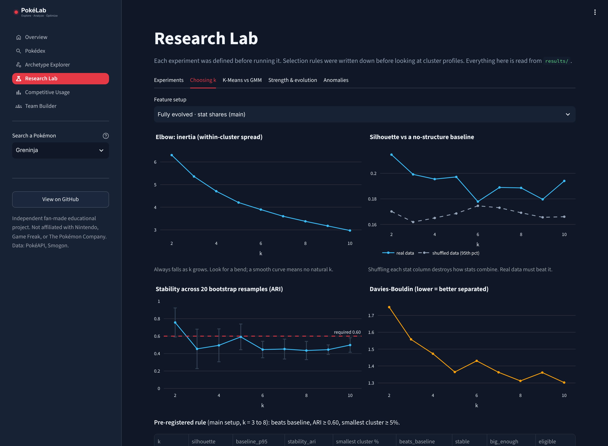
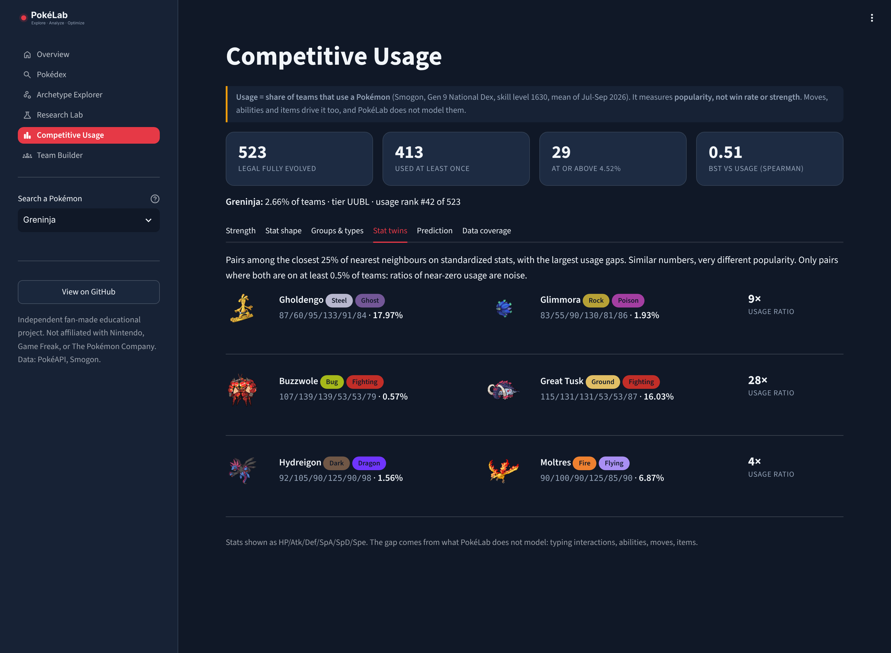

# PokéLab

**Machine learning, archetype discovery & team optimization on 1,025 Pokémon.**

PokéLab asks whether unsupervised learning can find meaningful "archetypes" in Pokémon base stats, which Pokémon are statistical outliers, whether stat profiles relate to competitive usage, and whether an integer program can build better-covered teams than simple heuristics. Every number in the app is read from saved experiment results; selection rules were fixed before looking at outcomes.

> PokéLab is an independent, fan-made educational project. It is not affiliated with, endorsed by, or connected to Nintendo, Game Freak, Creatures Inc., or The Pokémon Company. Pokémon names and images belong to their respective owners. Images are loaded from PokéAPI's public sprite host and are not redistributed in this repository.



---

## Key findings

| Question | Answer | Evidence |
|---|---|---|
| Do stable stat archetypes exist? | **No.** No k from 3–8 passed a pre-registered stability rule; k = 5 came closest (bootstrap ARI 0.591 vs 0.60 required). | EXP-04, EXP-05 |
| Is there *any* structure in stat shape? | **Weak, continuous structure.** Every k beats a shuffled-data baseline, but by ≤ 0.037 silhouette. Shape varies along two axes: fast ↔ bulky and physical ↔ special. | EXP-02 |
| Does a more flexible model help? | **No.** GMM is *less* stable than K-Means at every k (ARI 0.36–0.46) while reporting 83–89% confidence: model confidence is not stability. | EXP-03 |
| What does raw-stat clustering find? | **Evolution stage and power.** The k = 2 split matches "fully evolved vs not" for 92% of Pokémon. | EXP-01 |
| Which Pokémon are outliers? | Isolation Forest rankings are reproducible (Spearman 0.99 across seeds) and mostly match a one-extreme-stat rule (0.89–0.91); the forest adds value on unusual *combinations*. | ANOM-01 |
| Do stat profiles relate to competitive usage? | **Strength does, shape doesn't.** BST vs usage Spearman 0.51 (95% CI 0.44–0.58); role axes ≈ 0. Adding stats + types to BST gains only +0.04 held-out Spearman (better in 64% of folds). Stat twins differ up to 28× in usage. | EXP-06 |
| Does the optimizer beat simple team building? | **Yes, with a stated trade-off.** Only 4% of 10,000 random teams follow the rules and none reach the optimum; greedy falls 0.069 short; the 6 highest-BST Pokémon break the rules. The optimized team averages 563 BST vs 615. | OPT-01 |

The honest summary: **Pokémon stat profiles form a continuum, not archetypes. Total strength explains most of what stats can say about competitive popularity; abilities, moves and typing explain much of the rest.**

---

## Features

- **Pokédex** – search/filter all 1,025 species; stat bars, defensive matchups from the real type chart, role tags, competitive usage, anomaly rank, statistically similar Pokémon.
- **Archetype Explorer** – role map (stat shape) and strength map (raw stats), colorable by BST, usage, anomaly score, type or the *descriptive* k = 5 groups (labeled as not validated). Click a point to select it.
- **Research Lab** – all experiment records, k-selection evidence (elbow, silhouette vs baseline, bootstrap stability, Davies-Bouldin), K-Means vs GMM, anomalies.
- **Competitive Usage** – usage vs strength and shape with bootstrap intervals, stat twins, held-out prediction, and a data-coverage breakdown.
- **Team Builder** – a live integer program: adjustable weights and rules, lock up to 5 Pokémon (unevolved picks offer their final forms), per-member explanations, defensive heatmap, and a live benchmark against random, greedy and top-BST teams.

| Archetype Explorer | Team Builder |
|---|---|
|  |  |
| **Research Lab** | **Competitive Usage** |
|  |  |

---

## Tech stack

Python · pandas · NumPy · scikit-learn · SciPy · PuLP (CBC solver) · Streamlit · Plotly · matplotlib/seaborn (notebooks) · pytest

---

## Data sources

| Source | Used for | Notes |
|---|---|---|
| [PokéAPI](https://pokeapi.co) `pokemon-species`, `pokemon`, `type` | Stats, types, abilities, evolution links, type chart | Fetched Nov 2026; current-generation stats and types |
| [Smogon usage stats](https://www.smogon.com/stats/) `gen9nationaldex-1630` chaos JSON | Competitive usage | Mean of 2026-07, 08, 09; ~400k battles per month |
| [Pokémon Showdown](https://github.com/smogon/pokemon-showdown) `data/formats-data.ts`, `items.ts` | Legality (banned tiers), Mega Stones | Used only to remove banned Pokémon, never as model inputs |

**Cleaning decisions** (full table in `notebooks/01_data_collection.ipynb`):
- One row per species, using PokéAPI's default form. Megas, regional and alternate forms are excluded in this version.
- Two battle-form overrides under a written rule (default form left automatically on entering battle, no player action): Wishiwashi → School, Terapagos → Terastal. Palafin, Zacian/Zamazenta and others were considered and documented as not overridden. Overrides change at most 1 of the top-20 anomalies.
- Evolution stage and `is_fully_evolved` derived from `evolves_from` links (no extra API calls).
- Validation stops the pipeline on duplicates, missing stats, out-of-range stats or unknown types.

---

## Repository structure

```text
pokelab/
├── src/
│   ├── data/          fetch_pokemon (cached API client), build_dataset, form_overrides, fetch_competitive
│   ├── features/      preprocessing (the two representations), build_app_data
│   ├── models/        clustering, k_selection, gmm, anomaly_detection, competitive_analysis/prediction
│   ├── optimization/  type_chart, team_optimizer (integer program), explain, benchmark
│   ├── evaluation/    metrics (shuffled baseline, bootstrap stability), record_experiments
│   └── pipeline.py    rebuilds every result in order
├── app/               Streamlit app: dashboard.py, pages/, components/, theme.py
├── notebooks/         01 data · 02 EDA · 03 archetypes · 04 anomalies · 05 competitive
├── tests/             pytest suite (unit tests on known answers + checks on real outputs)
├── data/processed/    cleaned tables (committed); data/raw/ is a local API cache (not committed)
└── results/           experiment records and model outputs the app reads
```

---

## Methodology

### Features
Six base stats in two representations:
- **Standardized** (`StandardScaler`): keeps overall strength.
- **Relative** (stat ÷ total): keeps the *shape* of the stat budget. Rows sum to 1, so one column is redundant; this forces an average pairwise correlation of −1/5 (confirmed: −0.20), and GMM drops one column to avoid a singular covariance.

EDA found a confounder: BST is bimodal because of evolution stage. The apparent power creep across generations (median 405 → 483) is mostly a change in the share of unevolved Pokémon; fully evolved medians are flat at ~490–500 until Gen 9.

### Clustering and model selection
- K-Means (n_init = 10) and GMM (full covariance) for k = 2–10 on four setups (all / fully evolved × standardized / relative). Main setup: fully evolved, relative.
- **Pre-registered rule**, written before inspecting clusters: k ∈ 3–8 is eligible only if silhouette beats the 95th percentile of a **shuffled-column baseline** (same marginals, no joint structure), **bootstrap stability** ARI ≥ 0.60 (20 resamples, refit, label all original rows), and the smallest cluster ≥ 5%. Seed-only stability was rejected as uninformative (near-perfect with n_init = 10).
- PCA is used only for visualization; the 2D role map explains 60% of variation.

### Anomaly detection
Isolation Forest (500 trees) on three views. No ground truth exists, so no accuracy is reported; instead: seed stability, agreement with a max-|z| baseline, and a form-override robustness check. "Flagged" (top 5%) is a reporting cutoff, not a truth threshold.

### Competitive usage
Exact-form matching (Landorus-Therian's usage is not credited to Landorus-Incarnate's stats). Banned tiers removed. Spearman with 1,000-sample bootstrap intervals; Kruskal-Wallis across descriptive groups. Prediction: log usage, 5-fold × 10 repeated CV with identical folds per model, scaling fit inside folds, fixed hyperparameters, no usage-derived features.

### Team optimization (integer program)

Variables: `x_i ∈ {0,1}` (Pokémon i chosen), coverage depths `c_t, d_t ∈ [0,2]`, role coverage `g_r ∈ [0,1]`, stat floor `m ∈ [0,1]`.

```
maximize   w_cov · Σ_t c_t / 36  +  w_def · Σ_t d_t / 36  +  w_role · Σ_r g_r / 4  +  w_floor · m
subject to Σ_i x_i = 6
           c_t ≤ Σ_i OFF[i,t] x_i          (OFF: own-type attack is super-effective vs type t)
           d_t ≤ Σ_i RES[i,t] x_i          (RES: takes ≤ ½× from attacking type t)
           g_r ≤ Σ_i ROLE[i,r] x_i         (fast / bulky / physical / special)
           m   ≤ (1/6) Σ_i PCT[i,s] x_i    for each stat s   (maximin "stat floor")
           Σ_i WEAK[i,t] x_i ≤ max_load    (WEAK = 1 for 2×, 2 for 4×)
           Σ_i TYPE[i,T] x_i ≤ max_per_type
           x_i = 1 for locked Pokémon
```

The bounded auxiliary variables linearize "at least one/two members cover this type". Coverage counts depth up to 2 because with depth 1 the coverage terms saturated and the weights stopped mattering. Solved exactly with CBC (branch and bound); a test brute-forces every team on small pools and checks the solver matches.

---

## Limitations

- **Stats and types only.** Abilities, moves, items, EVs/IVs and Tera types are not modeled (e.g. Slaking scores well on BST despite an ability that halves its turns).
- **One form per species.** 27% of competitive usage belongs to forms outside the dataset (Megas ~13%, alternate forms ~10%, regional ~4%); Eviolite users (Chansey, Porygon2) are excluded as not fully evolved.
- **Usage ≠ strength.** Usage is popularity in one format, one skill level, three months. Only 29 Pokémon pass the 4.52% high-usage cutoff, so group comparisons are hints. Tests are exploratory.
- **Optimizer scope.** Measures type coverage and stat balance, not battle outcomes; weights are illustrative, not fitted. "Not legendary" in PokéAPI still includes Ultra Beasts and Paradox Pokémon. The stat-floor term has little room to vary under the default rules, so its weight acts mostly as a tie-breaker.
- **Descriptive groups** (k = 5) in the app are not validated archetypes.
- Showdown tier data comes from the live repository, frozen locally by the cache.

---

## Setup

Tested on Python 3.14 (Windows).

```bash
git clone https://github.com/Rsingh1010/pokelab.git
cd pokelab
python -m venv .venv
# Windows: .venv\Scripts\Activate.ps1    macOS/Linux: source .venv/bin/activate
pip install -r requirements.txt

python -m pytest                     # test suite
streamlit run app/dashboard.py       # the app works immediately from committed results
```

Rebuild every result:

```bash
python -m src.pipeline                 # full: downloads from PokéAPI and Smogon (cached), then all analysis
python -m src.pipeline --skip-download # analysis only, from committed data/processed files
```

---

## Future work

- Model alternate and Mega forms as separate rows.
- Add abilities and typing interactions as features; split the +0.04 prediction gain into typing vs stats.
- Multiple formats and skill levels for usage; chronological validation across months.
- Move-based offensive coverage in the optimizer.
